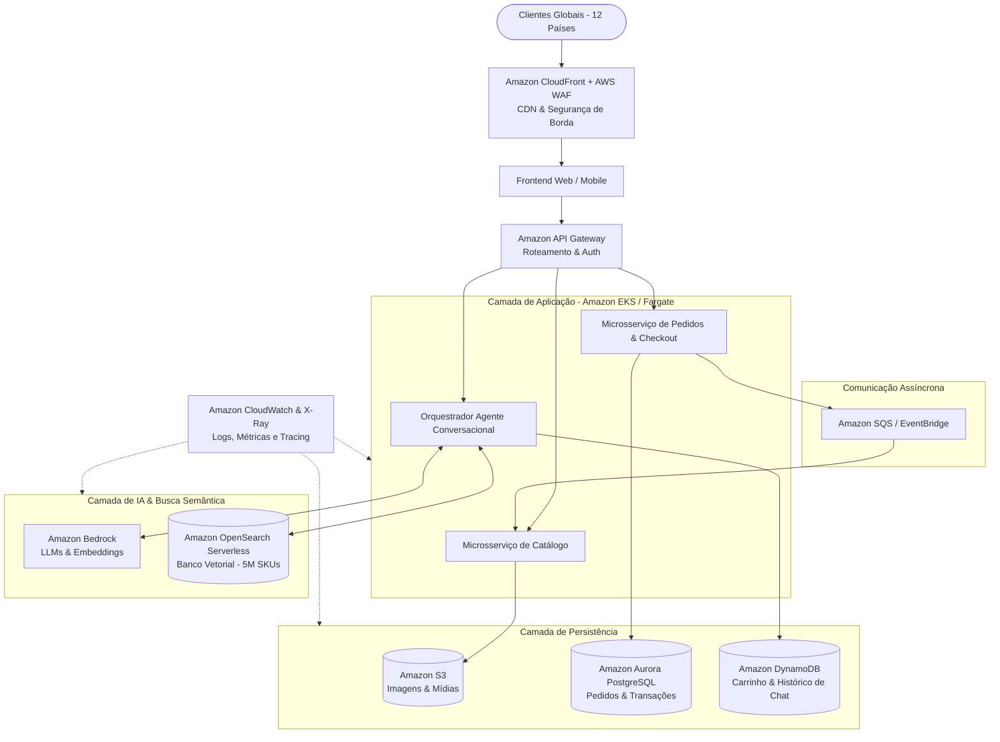

## 🟢 Nível 1 — Básico: Consolidando os Fundamentos
### Exercício 1.1 — Mapeamento de modelos de serviço
Para cada serviço, identifique-se como IaaS, PaaS, SaaS ou FaaS. Justifique em uma frase.

| Serviço | Modelo (IaaS/PaaS/SaaS/FaaS) | Justificativa |
| :--- | :--- | :--- |
| Gmail | SaaS | Software pronto para uso final acessado pelo navegador, sem necessidade de gerenciar servidores ou código. |
| Amazon EC2 | IaaS | Fornece máquinas virtuais (computação e rede), mas exige que você gerencie o sistema operacional, atualizações e aplicações. |
| AWS Elastic Beanstalk (hospedar uma API) | PaaS | Abstrai o gerenciamento da infraestrutura e do sistema operacional, permitindo focar apenas no deploy do código da aplicação. |
| AWS Lambda | FaaS | Executa trechos de código sob demanda orientados a eventos, sem provisionamento de servidores e com cobrança por execução. |
| Amazon RDS para PostgreSQL | PaaS | Banco de dados gerenciado onde a AWS cuida do provisionamento, backups e patches, enquanto você administra apenas os dados e schemas. |
| Salesforce CRM | SaaS | Plataforma completa de gestão de clientes entregue pronta pela nuvem, sem gestão de infraestrutura pelo usuário. |
| Google Kubernetes Engine (GKE) | PaaS/IaaS (Híbrido) | O Google gerencia o control plane do Kubernetes (PaaS), mas você ainda configura e administra os nós de trabalho e pods (IaaS). |
| Amazon S3 | PaaS (Storage gerenciado) | Serviço de armazenamento de objetos totalmente gerenciado, no qual você controla apenas os buckets, dados e permissões de acesso. |
| Amazon Bedrock | SaaS / API como serviço | Disponibiliza modelos fundacionais de IA prontos para consumo direto via API, sem exigir gerenciamento de infraestrutura ou treinamento base. |
**

---

### Exercício 1.2 — Os 6 Rs na prática

Leia cada cenário e escolha o R de migração mais adequado (Rehost, Replatform, Refactor, Repurchase, Retire, Retain). Justifique.

* **Cenário A:** Empresa de logística com sistema de rastreamento de frotas em servidor físico próprio. Código de 2008, sem documentação, só uma pessoa sabe mexer. Quer migrar rápido para ganhar elasticidade.
  * **Resposta:** Rehost
  * **Justificativa:** Como o sistema é antigo (2008), não possui documentação, tem baixa disponibilidade de conhecimento técnico interno e a prioridade é migrar rapidamente para ganhar elasticidade, mover a máquina virtual diretamente para a nuvem (ex.: Amazon EC2) sem alterar o código é a abordagem mais segura e ágil.
  
* **Cenário B:** Banco regional usa ERP local de RH. Análise mostra: menos de 5 usuários ativos por mês, dados raramente consultados.
  * **Resposta:** Retire
  * **Justificativa:** O sistema possui baixíssima utilização (menos de 5 usuários ativos por mês) e dados raramente consultados; desativá-lo (arquivando os dados históricos caso haja exigência legal) elimina custos desnecessários de manutenção e infraestrutura.
  
* **Cenário C:** Fintech tem API de pagamentos monolítica. Decida aproveitar a migração para refatorar em microserviços com K8s e orientado a eventos.
  * **Resposta:** Refactor
  * **Justificativa:** A empresa decidiu reescrever a aplicação monolítica para uma arquitetura nativa em nuvem baseada em microsserviços, Kubernetes e eventos, visando escalabilidade e agilidade de entrega.
  
* **Cenário D — Repurchase:** Varejo usa CRM desenvolvido internamente há 15 anos. SaaS de mercado atende 90% das necessidades por menor custo.
  * **Resposta:** Refactor
  * **Justificativa:** Como um produto SaaS de mercado já atende 90% das necessidades por um custo menor do que manter um legado interno de 15 anos, substituir a solução própria por uma assinatura comercial é a escolha mais eficiente.
  
* **Cenário E:** Instituição financeira tem mainframe com dados de clientes que precisam ficar on-premise por exigência do Banco Central.
  * **Resposta:** Retain
  * **Justificativa:** Devido a restrições regulatórias e de conformidade impostas pelo Banco Central, os dados precisam permanecer em ambiente *on-premise*, mantendo a carga de trabalho localmente enquanto outras partes do ecossistema podem ser integradas via arquitetura híbrida.

---

### Exercício 1.3 — Calculando o impacto do SLA

Sistema de e-commerce com SLA de 99,9%.

a) Quantas horas de inatividade por ano? b) Se processa R$ 50.000/hora em vendas, qual o impacto financeiro máximo por ano? c) Para reduzir o impacto para menos de R$ 50.000/ano, qual SLA mínimo seria necessário?

> **Fórmulas úteis:** Downtime anual (horas) = 8.760 × (1 - SLA/100) | Downtime mensal (min) = 43.800 × (1 - SLA/100)

* **a) Horas de inatividade por ano (SLA 99,9%):**
  $$\text{Downtime anual} = 8.760 \times \left(1 - \frac{99,9}{100}\right) = 8.760 \times 0,001 = \mathbf{8,76\text{ horas/ano}}\text{ (aproximadamente 8h 45min 36s)}$$

* **b) Impacto financeiro máximo por ano:**
  $$\text{Impacto financeiro} = 8,76\text{ horas} \times \text{R\$ } 50.000/\text{hora} = \mathbf{\text{R\$ } 438.000,00/\text{ano}}$$

* **c) SLA mínimo para reduzir o impacto para menos de R$ 50.000/ano:**
  * Primeiro, calcula-se o limite máximo de horas de indisponibilidade permitido:
    $$\text{Downtime máximo} < \frac{\text{R\$ } 50.000}{\text{R\$ } 50.000/\text{hora}} \implies \mathbf{< 1\text{ hora/ano}}$$
  * Aplicando na fórmula de SLA anual:
    $$8.760 \times \left(1 - \frac{\text{SLA}}{100}\right) < 1 \implies 1 - \frac{\text{SLA}}{100} < \frac{1}{8.760} \approx 0,00011415$$
    $$\text{SLA} > (1 - 0,00011415) \times 100 = \mathbf{99,9886\%}$$
  * **Conclusão:** Seria necessário um SLA mínimo de **99,99%** ("quatro noves"), o que limitaria a inatividade anual a **0,876 horas** (cerca de 52 minutos e 33 segundos), gerando um impacto máximo de **R$ 43.800,00/ano**.
 
---

### Exercício 1.4 — IAM na prática

Você é o responsável pela segurança da Quantum Commerce. Para cada perfil abaixo, escolha a política gerenciada da AWS (ou descreva a política customizada) mais adequada e justificada:

| Perfil | Política IAM mais adequada | Justificativa |
| :--- | :--- | :--- |
| Agente de IA que LÊ produtos do S3 para responder ao cliente | Política customizada com `s3:GetObject` e `s3:ListBucket` restrita ao ARN do bucket/prefixo específico | Aplica o princípio do menor privilégio, evitando conceder `AmazonS3ReadOnlyAccess` que exporia todos os outros buckets da conta. |
| Engenheiro de dados que CARREGA novos catálogos no S3 | Política customizada com `s3:PutObject` restrita ao prefixo `catalogo/` | Permite apenas o envio de novos arquivos no diretório específico de catálogos, impedindo alterações ou exclusões indevidas em outros dados. |
| Time de FinOps que precisa VER custos sem alterar recursos | `AWSBillingReadOnlyAccess` (política gerenciada pela AWS) | Garante acesso de leitura às informações de faturamento e Cost Explorer para análise financeira, sem permissão para criar, modificar ou excluir recursos. |
| Auditor externo que precisa LER configurações de toda a conta | `SecurityAudit` ou `ViewOnlyAccess` via IAM Role assumida | Permite inspecionar configurações e metadados de segurança de toda a conta sem alterar recursos, usando credenciais temporárias (sem usuário IAM permanente). |
| Sistema de CI/CD que provisiona infraestrutura via Terraform | IAM Role dedicada assumida via OIDC (ex.: GitHub Actions) com política customizada restrita aos serviços do projeto | Elimina o uso de chaves de acesso fixas (`Access Keys`) e limita o provisionamento apenas aos recursos necessários, evitando conceder `AdministratorAccess`. |

---

## 🟡 Nível 2 — Intermediário: Arquitetura em Nuvem

### Exercício 2.1 — Arquitetura de alto nível: Quantum Commerce

**Contexto:** A Quantum Commerce é um gigante do e-commerce com 12 países, 5M de SKUs, e quer transformar a experiência de compra com IA conversacional.

#### 1. Camadas da arquitetura

A arquitetura proposta é dividida em **6 camadas principais** para garantir escala global, baixa latência e resiliência entre os 12 países:

* **Camada de Borda e Entrega (Edge / Frontend):** Responsável por hospedar a interface web/mobile, distribuir conteúdo estático (imagens e vídeos dos 5M de SKUs) com baixa latência global via CDN e proteger a borda contra ataques DDoS e bots (WAF).
* **Camada de Entrada e Roteamento (API Gateway):** Ponto único de entrada que gerencia autenticação/autorização, *rate limiting*, roteamento geográfico e orquestração das requisições entre o frontend e os microsserviços internos.
* **Camada de Aplicação e Negócio (Backend / Microsserviços):** Contém os serviços desacoplados de catálogo, carrinho, checkout, pedidos e o orquestrador do agente de IA conversacional, comunicando-se de forma assíncrona via filas e eventos.
* **Camada de IA Generativa e Busca Semântica (AI / ML):** Gerencia os modelos fundacionais (LLMs) para atendimento conversacional, geração de embeddings dos produtos e busca vetorial (RAG) para recomendações personalizadas em tempo real sobre os 5 milhões de SKUs.
* **Camada de Persistência de Dados (Dados):** Armazena dados transacionais críticos (pedidos e pagamentos em banco relacional), sessões de chat e carrinhos em alta velocidade (NoSQL), índices vetoriais do catálogo e mídias em object storage.
* **Camada de Observabilidade e Governança:** Coleta logs distribuídos, métricas de infraestrutura/negócio, traces das chamadas de IA e alertas automatizados, além de gerenciar políticas de acesso (IAM) e segredos.

---

#### 2. Provedor principal escolhido e justificativa

* **Provedor escolhido:** **AWS (Amazon Web Services)**
* **Justificativa:**
  * **Capilaridade Global:** Possui regiões e *Edge Locations* (CloudFront) distribuídas estrategicamente na América do Norte, Europa, América Latina e Ásia, atendendo aos 12 países com baixa latência e conformidade de residência de dados (como LGPD e GDPR).
  * **Maturidade em IA Generativa (Amazon Bedrock):** Permite consumir múltiplos modelos fundacionais via API gerenciada com segurança empresarial, sem que os dados proprietários da Quantum Commerce sejam usados para treinar modelos públicos.
  * **Escala Comprovada em E-commerce:** Serviços nativos como DynamoDB (latência de milissegundos em qualquer escala), EKS/ECS e OpenSearch Serverless suportam picos extremos de tráfego (como Black Friday) sobre 5M de SKUs sem gargalos operacionais.

---

#### 3. Serviços por categoria

| Categoria | AWS | Alternativa Azure | Alternativa GCP |
| :--- | :--- | :--- | :--- |
| Computação (backend) | Amazon EKS / AWS Fargate | Azure Kubernetes Service (AKS) / Azure Container Apps | Google Kubernetes Engine (GKE) / Cloud Run |
| Armazenamento (catálogo, imagens) | Amazon S3 | Azure Blob Storage | Google Cloud Storage (GCS) |
| Banco relacional | Amazon Aurora / Amazon RDS (PostgreSQL) | Azure Database for PostgreSQL / Azure SQL | Cloud SQL / AlloyDB for PostgreSQL |
| Banco NoSQL | Amazon DynamoDB | Azure Cosmos DB | Cloud Firestore / Cloud Bigtable |
| Banco de dados vetorial | Amazon OpenSearch Serverless (Vector Engine) / pgvector no Aurora | Azure AI Search / Cosmos DB (Vector) | Vertex AI Vector Search / AlloyDB (pgvector) |
| Serviços de IA cognitivos | Amazon Bedrock | Azure OpenAI Service / Azure AI Foundry | Vertex AI (Gemini) |
| CDN | Amazon CloudFront | Azure Front Door / Azure CDN | Cloud CDN |
| Mensageria/Filas | Amazon SQS / Amazon EventBridge | Azure Service Bus / Azure Event Grid | Cloud Pub/Sub |
| Observabilidade (logs/métricas) | Amazon CloudWatch / AWS X-Ray | Azure Monitor / Application Insights | Cloud Logging / Cloud Monitoring / Cloud Trace |

---

#### 4. Diagrama de Arquitetura (Mermaid)

> Abaixo está o diagrama em código **Mermaid** (renderizado automaticamente pelo GitHub) e que também pode ser exportado ou recriado no **Excalidraw** / **draw.io** para anexar a imagem conforme solicitado na entrega.

---

### Exercício 2.2 — Comparativo de custos: 3 fornecedores

Você precisa recomendar infraestrutura para um projeto de Engenharia de IA. Use as calculadoras para comparar:

* 2 VMs com 2 vCPUs e 8 GB de RAM (Linux, 24/7)
* 500 GB de armazenamento de objetos
* 1 banco gerenciado com 2 vCPUs / 8 GB RAM / 100 GB
* 10 milhões de requisições/mês para função serverless

> **Premissas da simulação:** Região `us-east-1` / `East US` / `us-central1`, modelo *On-Demand* (730 h/mês), banco relacional PostgreSQL (Single-AZ, 100 GB SSD) e função serverless configurada com 512 MB de memória e duração média de 200 ms por execução (incluindo o *Free Tier* mensal padrão).

| Item | AWS | Azure | GCP | Notas |
| :--- | :--- | :--- | :--- | :--- |
| 2 × VM (2 vCPUs/8 GB) | US$ 121,47 | US$ 121,18 | US$ 97,85 | **Tipo:** AWS `t3.large` / Azure `Standard_B2ms` / GCP `e2-standard-2` |
| 500 GB de armazenamento | US$ 11,50 | US$ 10,40 | US$ 10,00 | **Tipo:** S3 Standard / Azure Blob Hot (LRS) / Cloud Storage Standard |
| Banco relacional gerenciado | US$ 107,07 | US$ 107,50 | US$ 92,35 | **Tipo:** RDS `db.t3.large` / Azure PostgreSQL Flexible `B2ms` / Cloud SQL `db-custom-2-8192` |
| 10 milhões de requisições serverless | US$ 16,67 | US$ 16,00 | US$ 18,40 | **Tipo:** AWS Lambda / Azure Functions / Cloud Run Functions (512 MB, 200 ms) |
| **Total mensal** | **US$ 256,71** | **US$ 255,08** | **US$ 218,60** | Valores estimados em dólar (USD) sob demanda (*On-Demand*) |
| **Total anual** | **US$ 3.080,52** | **US$ 3.060,96** | **US$ 2.623,20** | Projeção linear de 12 meses sem reservas |

#### Análise

* **a) Qual provedor ficou mais barato? A diferença é significativa?**
  * O **GCP (Google Cloud Platform)** apresentou o menor custo mensal (**US$ 218,60/mês**), gerando uma economia aproximada de **14,3% a 14,8%** (cerca de **US$ 36 a US$ 38 por mês**, ou **~US$ 440 a US$ 457 por ano**) em comparação com a AWS e o Azure, que ficaram praticamente empatados na faixa de **US$ 255 a US$ 257/mês**. Para cargas contínuas de menor porte, a diferença anual é relevante no orçamento, embora em grandes arquiteturas corporativas contratos corporativos e créditos de nuvem costumem equilibrar esses valores.

* **b) Aplicando Instâncias Reservadas de 1 ano no mais caro, o resultado muda?**
  * **Sim, o resultado muda e o provedor mais caro passa a ser o mais barato.** Aplicando um plano de compromisso de 1 ano (*Savings Plans / Reserved Instances* sem pagamento adiantado) na **AWS** (que teve o maior valor *On-Demand* de US$ 256,71), obtém-se um desconto médio de **~35% a 40%** na computação (EC2) e no banco de dados (RDS):
    * **2 × EC2 (`t3.large` - 1 ano reservado):** cai de US$ 121,47 para **~US$ 76,50/mês**
    * **RDS (`db.t3.large` - 1 ano reservado):** cai de US$ 107,07 para **~US$ 69,60/mês**
    * **Novo total mensal na AWS:** **~US$ 174,27/mês** (**US$ 2.091,24/ano**), superando o preço *On-Demand* do GCP (US$ 218,60/mês). *(Nota: se o GCP também aplicar Committed Use Discounts de 1 ano, ele volta a disputar a liderança na faixa de ~US$ 155–165/mês).*

* **c) Além do preço, que outros fatores você consideraria para um projeto de IA?**
  * **Ecossistema de Modelos Fundacionais e APIs Gerenciadas:** Disponibilidade e variedade de LLMs de ponta sem precisar gerenciar GPUs (ex.: *Amazon Bedrock* com Claude/Llama, *Azure OpenAI Service* com modelos GPT ou *GCP Vertex AI* com Gemini).
  * **Disponibilidade e Custo de GPUs/TPUs:** Facilidade para obter cotas (*quotas*) de instâncias aceleradas (NVIDIA L4, A100, H100) caso o projeto exija *fine-tuning* ou inferência de modelos próprios.
  * **Integração com Bancos Vetoriais e Pipelines de Dados:** Suporte nativo a busca vetorial (RAG), governança de dados, segurança empresarial (privacidade de prompts, isolamento de rede via VPC/PrivateLink) e conformidade regulatória (LGPD/GDPR).
  * **Maturidade da Equipe e *Vendor Lock-in*:** Conhecimento técnico atual do time de engenharia e portabilidade da arquitetura usando ferramentas abertas (Terraform, Kubernetes, Docker, LangChain).

#### Calculadoras utilizadas

* **AWS:** https://calculator.aws
* **Azure:** https://azure.microsoft.com/pricing/calculator
* **GCP:** https://cloud.google.com/products/calculator
